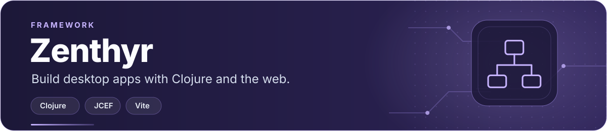

# 

An alpha desktop application library and Leiningen template. A Clojure JVM backend hosts a Chromium window, while React, Vue, Svelte, or Angular can provide the interface.

[](https://github.com/svazqz/zenthyr/actions/workflows/ci.yml)

[Quick start](#quick-start) · [Validation](#validation) · [Project layout](#project-layout) · [Reference](#reference) · [License](#license)

## Quick start

Use a JDK, Leiningen, and Node.js. Install the local Leiningen template, then generate an app.

```sh
(cd template && lein install)
lein new zenthyr my-app
cd my-app
lein run
```

The reference describes frontend options, IPC, and the macOS-first window lifecycle.

## Validation

```sh
lein test
```

Launch a generated app on macOS to smoke-test the desktop window and frontend bridge.

## Project layout

| Path | Purpose |
| --- | --- |
| [`src/`](src/) | Clojure runtime and native integration |
| [`template/`](template/) | Leiningen project template |
| [`test/`](test/) | Library tests |
| [`CHANGELOG.md`](CHANGELOG.md) | Version history |

## Reference

Read the [project reference](README.reference.md) for detailed examples, configuration, and original notes.

## License

See [`LICENSE`](LICENSE) for license terms.

See [third-party notices](THIRD_PARTY_NOTICES.md) for bundled or external dependencies.
